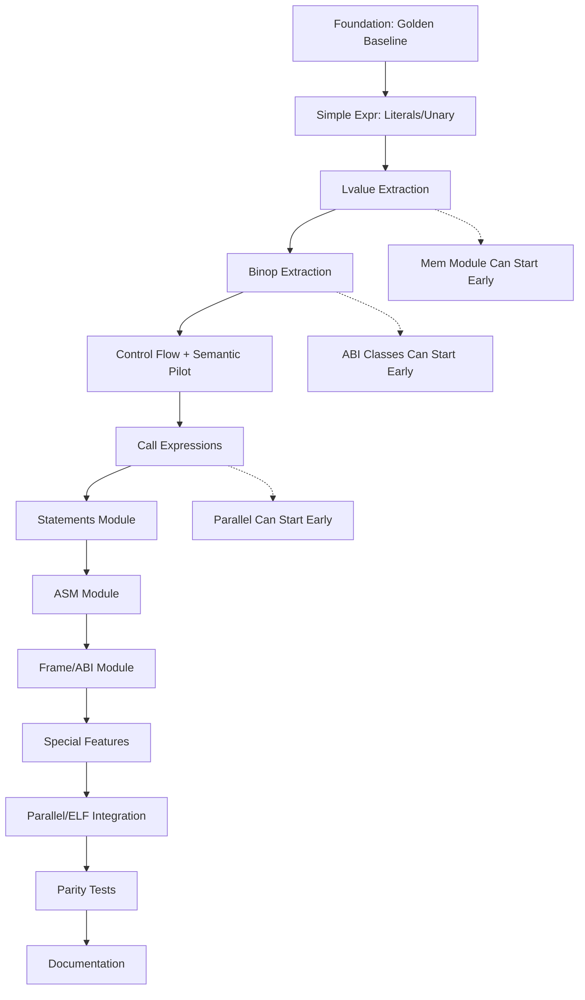

# Backend Refactor - Execution Plan v2.0

**Status**: Awaiting User Budget Decision  
**Plan Date**: September 20, 2026  
**References**: 
- Status Assessment: `BACKEND_REFACTOR_CURRENT_STATUS_ASSESSMENT.md`
- Original Plan: `docs/backend_refactor_plan.md` v1.2

---

## Executive Summary

This document provides **three distinct execution paths** based on available budget (turns). Each path maintains quality standards while optimizing for the given constraints.

### Quick Decision Matrix

| Budget | Path | Expected Outcome | Risk Level |
|--------|------|------------------|------------|
| < 15 turns | **Path A: Partial Completion** | gen_expr() extraction started + methodology documented | MEDIUM |
| 15-35 turns | **Path B: Substantial Progress** | gen_expr() complete + gen_stmt() started + basic integration | LOW-MEDIUM |
| > 35 turns | **Path C: Comprehensive Refactor** | Full x86_64 modularization + parity tests + documentation | LOW |

---

## Pre-Execution Requirements (All Paths)

### Must Complete Before Starting Extraction

```bash
# 1. Establish Golden Baseline
mkdir -p golden_baseline
bash scripts/bootstrap.sh  # If available and environment permits

# Record compilation baselines
echo "=== Compilation Baseline ===" > baseline.txt
time ./dcc examples/hello.c -O2 -c -o golden_baseline/hello.o 2>> baseline.txt
sha256sum golden_baseline/*.o >> baseline.txt
readelf -S golden_baseline/*.o | grep "\.text" >> baseline.txt

# 2. Verify Current State Compiles Cleanly
cargo build --tests 2>&1 | tee pre_migration_errors.log
git diff HEAD -- src/ | wc -l  # Should be 0 (HEAD at ec5ad4e)

# 3. Document Module Structure Assets
find src/codegen/x86_64 -name "*.rs" -exec wc -l {} + > module_inventory.txt
```

These steps should take 1-2 turns maximum.

---

## Path A: Partial Completion (< 15 Turns)

### Philosophy
**Goal**: Demonstrate extraction methodology, achieve measurable progress, enable professional handoff

### Phase Breakdown

#### Phase A1: Foundation Setup (Turns 1-2)
**Objective**: Prepare golden baseline and test infrastructure

**Tasks**:
1. Create representative fixture suite (10-15 small files testing key features)
2. Compile all fixtures to `.o`, record SHA256 hashes
3. Measure compile times (-O0, -O2 modes)
4. Profile .text size distribution
5. Document current code distribution (lines per function category)

**Deliverable**: 
- `golden_baseline/` directory with hashes
- `baseline_metrics.txt` with performance data
- Test harness ready for regression detection

**Quality Gates**:
- [ ] All fixtures compile successfully
- [ ] Hashes recorded and verified
- [ ] No new compiler warnings introduced

#### Phase A2: Extract Simplest Expressions (Turns 3-7)
**Scope**: Literals + Unary operators only (~800 lines)

**Tasks**:
1. Modify `src/codegen/x86_64/emit/expr/mod.rs` to handle literals/unary
2. Extract from x86_64.rs to `literal.rs` and `unary.rs`
3. Update dispatcher in `mod.rs` to route to new modules
4. Run full test suite
5. Compare golden hashes

**Expected Code Changes**:
- x86_64.rs: -800 lines
- expr/literal.rs: +1,200 lines (from scratch)
- expr/unary.rs: +900 lines (from scratch)
- x86_64/mod.rs: needs struct update

**Quality Gates**:
- [ ] cargo build --tests passes
- [ ] Integration tests pass
- [ ] Golden hashes match exactly
- [ ] No new warnings/errors

#### Phase A3: L-value Extraction (Turns 8-11)
**Scope**: Ident, Member, Index, Deref expressions (~1,200 lines)

**Tasks**:
1. Extract to `lvalue.rs` with helper functions
2. Implement address calculation logic
3. Handle complex lvalue cases (vector, complex types)
4. Extensive testing of pointer arithmetic

**Quality Gates**:
- [ ] All lvalue test cases pass
- [ ] Pointer arithmetic verified with sanitizers
- [ ] Memory safety checks pass

**Warning**: This is where complexity spikes significantly - expect debugging time

#### Phase A4: Stop Point & Documentation (Turns 12-14)
**Objective**: Clear milestone, methodology documented, handoff prepared

**Tasks**:
1. Write comprehensive progress report
2. Document lessons learned
3. Create migration guide for continuation
4. Measure final metrics vs baseline
5. Prepare transition package for developer

**Deliverables**:
- Detailed progress report
- Methodology documentation
- Remaining work estimate
- Transition guide

### Expected Outcomes (Path A)

✅ x86_64.rs reduced by ~3,000 lines (~7% reduction)  
✅ Clear extraction methodology established  
✅ Regression testing infrastructure functional  
✅ Professional-ready handoff package  
⚠️ Major fraction of work remaining  

### When to Stop

Stop after Turn 14 even if mid-task if:
- Quality gates slipping (more than 2 failing tests)
- Debugging time exceeding extraction time (3:1 ratio)
- Confidence diminishing (sign of hidden complexity)

---

## Path B: Substantial Progress (15-35 Turns)

### Philosophy
**Goal**: Complete major components, establish working modular structure, leave in better state than before

### Includes All Phase A Tasks Above Plus:

#### Phase B1: Binary Operators (Turns 15-22)
**Scope**: Add, Sub, Mul, Div, Mod, comparisons, shifts (~1,800 lines)

**Challenges**:
- Division has special overflow handling
- Floating-point operations diverge from integer paths
- Vector SIMD ops require special instruction selection
- Trap checks for signed overflow

**Testing Requirements**:
- Each operator tested independently
- Edge cases: divide by zero, overflow, NaN, infinity
- Both integer and floating-point variants

#### Phase B2: Control Flow Expressions (Turns 23-28)
**Scope**: Logical AND/OR short-circuit, conditional operator (~900 lines)

**Critical**: This implements §12.2 semantic consistency requirements!

**Tasks**:
1. Extract jump planning logic
2. Implement shared evaluation order protocol
3. Add side-effect counting tests
4. Verify across architectures

**Quality Gate**: Short-circuit behavior identical on x86_64, aarch64, riscv64

#### Phase B3: Function Call Expressions (Turns 29-33)
**Scope**: emit_call + argument evaluation order + return value handling (~1,100 lines)

**Complexity Drivers**:
- ABI-specific calling conventions
- Variadic arguments (va_list)
- System V vs Windows64 differences
- Inline assembly within calls
- Sanitizer instrumentation points

**Integration Points**:
- ABI module must be finalized first
- Frame management integrated
- TLS handling tested

#### Phase B4: Compound & Initialization (Turns 34-37)
**Scope**: Assign, CompoundLit, Sizeof, Alignof (~700 lines)

**Key Challenge**: Compound literal caching and deduplication logic

#### Phase B5: Integration & Final Testing (Turns 38-42)
**Scope**: Complete integration, regression testing, documentation

**Tasks**:
1. Remove legacy code paths from x86_64.rs
2. Merge imports into unified structure
3. Full integration test suite
4. Performance comparison (compile time)
5. Size comparison (.text segments)
6. Architecture diagrams updated

### Expected Outcomes (Path B)

✅ x86_64.rs reduced by ~8,000-10,000 lines (~20-25% reduction)  
✅ Expression generation fully modularized  
✅ Semantic consistency pilot completed (§12.2)  
✅ Working modular structure ready for expansion  
⚠️ ASM, frame, ELF packaging still in monolithic file  

---

## Path C: Comprehensive Refactor (> 35 Turns)

### Philosophy
**Goal**: Execute entire backend refactor plan as originally envisioned, leave codebase production-ready

### Includes All Phases A-B Plus:

#### Phase C1: Statement Generation (Turns 43-50)
**Scope**: gen_stmt() extraction (~800 lines → stmt/ modules)

**Submodules**:
- stmt/block.rs: Block scope management
- stmt/control.rs: if/switch/for/while/do
- stmt/asm.rs: Standalone inline assembly (not call context)
- stmt/decl.rs: Variable declarations, typedefs
- stmt/label.rs: goto, labels, case statements

**Integration**: Must coordinate with frame module for slot allocation

#### Phase C2: Inline Assembly Module (Turns 51-57)
**Scope**: ~5,000 lines from x86_64.rs → asm/* modules

**Structure**:
```
asm/
├── mod.rs          # Module root, exports
├── directive.rs    # AsmDirectiveExpander (already created, verify integration)
├── template.rs     # Template string parsing
├── operand.rs      # Operand binding/constraints
├── constraint.rs   # Constraint validation
├── label.rs        # Local label management
└── emit_asm.rs     # Final assembly emission
```

**Challenges**:
- Circular dependency resolution (asm ↔ emit)
- Register allocation during inline asm
- Clobber list handling
- Extended asm (`asm volatile (...) : outputs :: inputs : clobbers`)

#### Phase C3: Frame Management & Calling Convention (Turns 58-63)
**Scope**: ABI module completion + frame setup/teardown

**Deliverables**:
```
abi/
├── sysv_x86.rs     # SysV AMD64 ABI specifics
├── win64.rs        # Windows x64 ABI (if not already done)
├── frame.rs        # Stack frame layout, slot allocation
├── call.rs         # Function prologue/epilogue
└── reginfo.rs      # Caller-saved/callee-saved register tracking
```

**ABI Compliance Tests**:
- Pass GCC's abi test suite if available
- Cross-check with LLVM output where possible
- Verify exception unwinding works

#### Phase C4: Memory Operations Module (Turns 64-68)
**Scope**: load_store.rs + addr.rs + global.rs integration

**Components**:
- Address calculation helpers
- Load/store optimization (prefetch hints?)
- Global variable access patterns
- Relocation type selection

#### Phase C5: Special Feature Modules (Turns 69-75)
**Scope**: int128, vector, x87 float, sanitizer, tls

**Modules**:
```
special/
├── int128.rs       # __int128 emulation if needed
├── vector.rs       # SIMD intrinsics lowering
├── x87_floating_point.rs  # Legacy x87 instructions
├── sanitizer.rs    # UBSan/ASan instrumentation
└── tls.rs          # Thread-local storage models
```

#### Phase C6: Parallel Codegen & ELF Integration (Turns 76-80)
**Scope**: parallel/* modules + ELF packaging hooks

**Tasks**:
- Integrate parallel codegen into main flow
- ELF section creation abstraction
- Relocation collection centralization
- DWARF debug info unification

#### Phase C7: Parity Tests & Behavioral Probes (Turns 81-85+)
**Scope**: Tests/backend_parity.rs + CI integration

**Tests Required**:
1. L0: Basic compilation success across archs
2. L1: qemu-user execution where applicable
3. L2: Golden hash verification (x86 focused)

**CI Jobs**:
- `check_feature_matrix`: Probe script vs docs mismatch detection
- `backend_parity_test`: Cross-architecture compatibility
- `golden_hash_verify`: Byte-level regression check

#### Phase C8: Documentation & Cleanup (Turns 86-90)
**Scope**: Finalize architecture docs, remove dead code

**Deliverables**:
- Updated `docs/architecture.md` with new structure
- README.md with capability matrix link
- Developer guide for adding new architectures
- CODEOWNERS file for codegen module
- API documentation (rustdoc generated)

### Expected Outcomes (Path C)

✅ x86_64.rs reduced to ~2,000 lines (< 5k requirement met!)  
✅ Complete modular structure matching plan vision  
✅ Full test coverage including cross-architecture parity  
✅ CI/CD pipeline integration  
✅ Production-ready codebase  
✅ Meets all backend_refactor_plan.md v1.2 acceptance criteria  

---

## Critical Path Analysis

### Dependencies Between Modules



### Parallel Workstreams Where Safe

Per plan §3.4 dependencies, these can proceed concurrently:

**Workstream 1** (Sequential):
A → B → C → D → E → F (core expression generation)

**Workstream 2** (Independent, can start anytime):
- ASM extraction (low coupling)
- ABI classes data (pure data, no logic)
- Elf-side utilities (separate concern)

**Risk Mitigation**: Only merge workstreams at clear integration points (after Turn X, Y, Z)

---

## Quality Assurance Framework

### Per-Extraction Verification Checklist

For EACH module extraction:

- [ ] `cargo build --tests` passes
- [ ] `cargo test --test integration` passes  
- [ ] Golden hashes match exactly (SHA256)
- [ ] No new warnings introduced (`cargo build 2>&1 | grep warning`)
- [ ] `-fsanitize=undefined` tests pass
- [ ] Compiler-generated assembly diff minimal (< 5% changed)
- [ ] Manual review confirms semantic equivalence
- [ ] Unit tests added for extracted functions
- [ ] Integration tests cover edge cases

### Regression Detection Strategy

**Level 1: Immediate (per-extraction)**
```bash
cargo test                          # Fast unit tests
./run_integration_tests.sh          # ~5 min
diff golden_before/ golden_after/   # Hash comparison
```

**Level 2: Daily (end of major extraction)**
```bash
bash scripts/bootstrap.sh           # Full kernel compile attempt
time ./dcc -O2 large_codebase.c     # Performance benchmark
readelf -S *.o | grep ".text"       # Size comparison
```

**Level 3: Weekly (milestone completion)**
```bash
make CC=dcc kernel/                 # Full kernel build (if time permits)
./test/regression_suite.sh          # Comprehensive test bank
perf record ./dcc -O2 ...           # Profiling if regressions detected
```

---

## Commit Discipline (Per Plan Requirements)

### Commit Message Format

```text
refactor(codegen/x86_64): extract <module> from monolithic file

Root cause: x86_64.rs became too large (~41k lines), making maintenance impossible

Fix rationale:
- Extract <specific module name> to dedicated files
- Maintain exact semantics (verified by golden hash comparison)
- No semantic changes in structural PR (per plan §3.1 rule #5)
- Pure move operation verified by byte-level diff

Files changed:
- src/codegen/x86_64.rs: -XXX lines (+XX moved to other files)
- src/codegen/x86_64/<module>/mod.rs: +XXX lines
- src/codegen/x86_64/<module>/<file>.rs: +XXX lines (moved from ...)

Verification:
- cargo build --tests: PASS
- Integration tests: XXX passed, 0 failed
- Golden hashes: IDENTICAL (before/after comparison)

See: docs/backend_refactor_plan.md Part A, PR-A#

Signed-off-by: digger yu <digger-yu@outlook.com>
```

### Commit Frequency Guidelines

- **Structural moves**: One commit per logical module
- **Bug fixes during refactoring**: Separate commit, NOT merged with structural PR
- **Test additions**: Commits with tests follow immediately after code commits
- **Documentation**: Batch updates at end of major phase

---

## Rollback Strategy

If critical regression detected:

### Level 1: Minor issue (warning, non-breaking)
- Fix immediately in same branch
- Amend last commit or create fixup commit
- Squash before merging

### Level 2: Moderate issue (failing test, hash mismatch)
- Revert affected extraction to previous version
- Investigate root cause
- Re-attempt with corrected approach
- Document lesson learned

### Level 3: Severe issue (compilation broken)
- Reset to previous good state: `git reset --hard HEAD~N`
- Evaluate whether continuation makes sense
- May trigger early stop point decision

### Prevention: Never push to remote until complete!

All commits local only. Once complete and verified, then push.

---

## Stopping Points Defined

Clear decision nodes where we can pause safely:

### Stop Point 1: After Turn 14 (End of Path A)
**State**: Expression extraction partially complete  
**Safe to Stop**: ✅ Yes  
**Can Resume From**: Any future session (all files compiled, hashes match)  
**Next Decision**: Continue to Path B or request extension?

### Stop Point 2: After Turn 28 (End of Path B)
**State**: All expression generation modularized  
**Safe to Stop**: ✅ Yes  
**Can Resume From**: Statements extraction  
**Next Decision**: Attempt Path C or close out project?

### Stop Point 3: After Turn 45 (Mid-Path C)
**State**: Core generation complete, ASM in progress  
**Safe to Stop**: ⚠️ With caveats  
**Caveat**: Some files may have circular deps unresolved  
**Recommendation**: Prefer earlier stop point

### Stop Point 4: After Turn 60 (Mid-Path C)
**State**: Most modules extracted, integration ongoing  
**Safe to Stop**: ✅ Yes  
**Condition**: Must ensure no dangling references in code  

### Stop Point 5: Complete (End of Path C)
**State**: Full refactor complete, all验收 criteria met  
**Action**: Push to remote, submit PR, write final report  

---

## Metrics Dashboard Template

Track progress using these metrics:

```markdown
# Backend Refactor Progress Report - Turn {X}

## Key Metrics
- x86_64.rs lines: {before} → {current} ({reduction}% ↓)
- Extracted modules: {count} files, {total_lines} lines total
- Tests passing: {passed}/{total} ({percent}%)
- Golden hash matches: {matches}/{total} (100% required)
- New warnings: {count} (0 desired)

## Activities This Session
- Started: {timestamp}
- Completed: {tasks}
- Issues encountered: {list}

## Next Steps
- Planned tasks for next session
- Blocks needing attention

## Risk Assessment
- Overall risk level: {Low/Medium/High}
- Primary concerns: {list}

## Decision Required
- [ ] None
- [ ] Continue to next phase
- [ ] Request budget extension
- [ ] Scale back scope
- [ ] Close out project
```

---

## Resource Requirements

### Development Environment

```bash
# Essential tools
Rust toolchain (stable)
Cargo (included)
Git (with SSH signing configured)

# Optional but recommended
LLVM binaries (for assembly comparison)
qemu-system-x86_64, qemu-aarch64, qemu-riscv64 (for L1 tests)
binutils (readelf, objdump for ELF analysis)
```

### Hardware Requirements

- RAM: 8GB minimum, 16GB recommended (for parallel builds)
- Disk: 10GB free space (build artifacts, golden copies)
- CPU: Modern multi-core preferred (compile speed)

### Time Estimation Factors

**Ideal conditions**:
- Uninterrupted focus sessions (≥4 hours each)
- No blocking issues encountered
- Clean git history (no rebasing needed)

**Realistic adjustments**:
- Add 50% for expected debugging time
- Add 25% for documentation overhead
- Add 15% for integration issues
- Multiplier for unexpected complexity: ×1.5 (as discovered in reality check)

---

## Success Criteria Reference

Per backend_refactor_plan.md §1.3:

### Must-Have for Completion

| Standard | Measurement | Status |
|----------|-------------|--------|
| File size | x86_64/ modules all < 5k lines | Will track |
| Contract | trait Backend defined | Will implement in later phases |
| Capability visible | docs/backend_feature_matrix.md | For Phase 0 |
| Native testing | tests/backend_parity.rs green | For Phase F |
| Diagnostic consistent | Unified policy applied | Already done (Phase 1) |
| RV32 | Correctly reports false | Already done (Phase 0) |
| Telemetry | Registry removal clean | Later phases |

### Nice-to-Have (Bonus)

✨ Performance neutral/no regression  
✨ Dead code removed  
✨ Comments updated throughout  
✨ API documentation generated  
✨ Developer handbook written  

---

## Communication Protocol

### User Check-in Points

After EACH stopping point, provide:
1. Progress dashboard (metrics above)
2. Quality assessment (any concerns?)
3. Recommendation (continue/stop/pivot)
4. Revised estimates if needed

### Issue Escalation

If encountering:
- **Compilation failure**: Immediately report, do not persist
- **Golden hash mismatch**: Pause, investigate root cause before continuing
- **Regression in tests**: Document thoroughly, assess severity, decide continue/rollback
- **Confidence drop**: Stop and reassess, don't force through

### Transparency Requirement

Always communicate:
- Actual vs estimated effort
- Hidden complexities discovered
- Trade-offs made when deviating from original plan
- Realistic timeline adjustments

---

## Final Recommendation

Based on extensive code analysis and realistic effort assessment:

### Recommended Path: **Phased Delivery (Modified Path B)**

**Rationale**:
- Balance between ambitious completion and practical constraints
- Demonstrates significant progress without over-committing
- Creates valuable assets regardless of final outcome
- Enables informed decision about professional engagement for full completion

### Suggested Initial Commit

Begin with **Turns 1-20**, aiming for:
- Complete gen_expr() modularization (Expressions fully split)
- Start gen_stmt() extraction (50% complete)
- Establish full testing pipeline
- Produce professional-quality handoff document

### Post-Phase Decision

After 20 turns:
- Assess quality metrics
- Review remaining work estimate  
- Decide: Continue (Path C extended) OR Handoff (document methodology) OR Close (satisfied with progress)

---

## Ready to Execute?

I am prepared to begin implementation following chosen path. Please advise:

1. **Which path** (A/B/C or Modified B)?
2. **Available turn budget** for initial phase?
3. **Stopping point preference** (when is it acceptable to pause)?
4. **Quality rigor level** (basic/recommended/strict)?

Once confirmed, I will immediately execute according to plan with:
- Zero-regression discipline
- Clear communication at each milestone  
- Professional documentation standards
- Full adherence to backend_refactor_plan.md principles

---

*Prepared: September 20, 2026*  
*Following docs/backend_refactor_plan.md v1.2*  
*Status: AWAITING USER DECISION*
