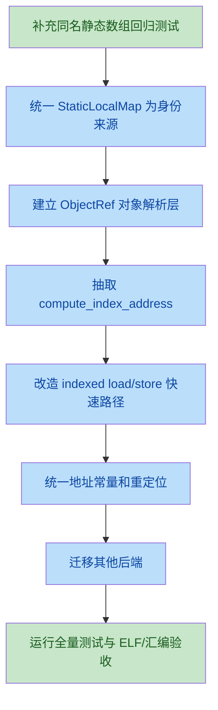

# 数组下标寻址重构方案

> **路径勘误（2026-10，SSA 目录化）**：本文里的 `src/ssa.rs` 等旧路径**不改写**（当时的事实）。
> 拆涉到的位置：IR 形态在 `src/ssa/ir.rs`，降级在 `src/ssa/build.rs`/`lower.rs`，
> 重建在 `src/ssa/rebuild.rs`/`expr_rebuild.rs`。对照表见
> [`docs/ssa-module-layout-plan.md` §10](./ssa-module-layout-plan.md)。

## 1. 问题定义

当前问题为：**静态数组的下标访问使用了错误的基址**。

典型场景是函数内静态数组与文件级对象存在同名或作用域重叠时，数组下标表达式的后端快速路径按源名称直接查询 `globals`，随后把该名称作为全局符号参与寻址或重定位。静态局部变量实际已经被改写为 mangled 符号，但数组索引路径没有在选择寻址策略之前完成同样的对象解析，因此可能访问文件级数组、错误的符号，或生成与真实对象不一致的重定位。

该问题本质上不是单条指令编码错误，而是以下语义边界没有统一：

- 源级标识符到对象实体的解析；
- 数组到首元素指针的衰减；
- 数组、指针、VLA、向量作为下标基址时的区别；
- lvalue 地址计算与 rvalue 加载；
- 全局/静态局部/栈对象的存储位置选择；
- ET_EXEC、ET_REL、PIE/非 PIE 下的重定位处理。

## 2. 代码现状

### 2.1 AST 与 IR 保留了数组结构

`Expr::Index` 在 AST 中保存数组表达式和索引表达式，类型信息继续保留数组、指针、VLA 等差异。typed IR 中也有独立的 `ExprKind::Index`，说明数组索引具备进入独立寻址语义层的基础。

参考：

- [ast.rs](../src/ast.rs)
- [ir.rs](../src/ir.rs)

### 2.2 x86-64 存在多套数组寻址路径

当前 x86-64 后端至少有以下路径：

1. `gen_expr` 处理 `Expr::Index`，负责数组元素作为值时的加载；
2. `gen_lvalue_addr` 处理 `Expr::Index`，负责 `&arr[i]`、赋值目标及聚合对象地址；
3. `Expr::AddrOf` 内部处理数组元素和成员链；
4. `emit_index_scale` 处理元素大小、VLA stride 和运行时对象大小；
5. `emit_load_global_indexed` 为全局数组提供 SIB 快速加载；
6. `emit_global_addr`、`emit_global_load` 处理普通全局或静态局部对象；
7. `const_eval` 计算全局初始化器中的地址常量；
8. `eval_global_lvalue_offset` 计算静态初始化地址偏移。

主要实现位置：

- [x86_64.rs](../src/codegen/x86_64.rs#L11456)
- [x86_64.rs](../src/codegen/x86_64.rs#L18931)
- [x86_64.rs](../src/codegen/x86_64.rs#L17504)
- [x86_64.rs](../src/codegen/x86_64.rs#L19777)
- [const_eval.rs](../src/const_eval.rs#L70)
- [const_eval.rs](../src/const_eval.rs#L91)

### 2.3 当前快速路径的危险点

`gen_expr` 的标识符数组快速路径先使用源名称查询 `self.globals`，判断是否为全局数组，再将原名称传给 `emit_load_global_indexed`。该判断发生在 `resolve_global_key` 之前。

问题位置：

- [x86_64.rs](../src/codegen/x86_64.rs#L11471-L11487)
- [x86_64.rs](../src/codegen/x86_64.rs#L17504-L17523)

当前静态局部变量通过 `StaticLocalMap` 解析为类似 `.Lsl<N>.<func>.<name>` 的符号：

- [static_locals.rs](../src/static_locals.rs#L36-L82)
- [x86_64.rs](../src/codegen/x86_64.rs#L20810-L20824)

但快速路径的“是否全局数组”判断和全局数组的 SIB 重定位没有使用同一个已解析对象身份。这使得以下情况不可靠：

```c
int a[4];

int f(void) {
    static int a[4] = {1, 2, 3, 4};
    return a[2];
}
```

`a` 在函数 `f` 内应解析为静态局部数组，但快速路径可能把源名称 `a` 识别为文件级数组，并让 indexed load 直接引用文件级符号。

## 3. 根因分析

### 3.1 对象身份解析晚于寻址策略选择

正确顺序应是：

```text
源名称 + 当前函数/作用域
        ↓
解析为唯一对象实体
        ↓
确定对象存储类别和符号
        ↓
确定数组/指针/VLA 基址规则
        ↓
计算索引字节偏移
        ↓
生成地址或加载/存储
```

当前部分路径实际是：

```text
源名称
  ↓
直接查询 globals
  ↓
选择“全局数组快速路径”
  ↓
再在局部路径中尝试解析静态局部
```

因此同一表达式在不同分支中可能对应不同对象。

### 3.2 `globals` 同时承担了过多职责

`globals` 当前既表示：

- 文件级全局变量；
- 静态局部变量的 mangled 符号；
- TLS 对象；
- 数据段和 BSS 的布局信息；
- 部分重定位所需的符号信息。

但查询接口仍大量接受源名称字符串。只要查询调用者忘记调用 `resolve_global_key`，就会产生“源名”和“链接名”混用问题。

### 3.3 数组地址与数组元素值没有统一抽象

目前数组相关逻辑分布在 `gen_expr` 和 `gen_lvalue_addr` 中：

- 数组基址可能来自 `LEA`；
- 指针基址必须加载指针值；
- VLA 基址必须从栈槽加载；
- 数组元素为数组时要执行数组衰减；
- 普通元素要执行加载；
- 聚合元素需要返回地址并进行整体拷贝。

这些规则通过多层 `if` 和类型匹配表达，导致每增加一种存储类别或对象类型，都要同时修改多个路径。

### 3.4 现有静态局部改造没有完全贯通寻址层

静态局部分析和预注册已经独立成 [static_locals.rs](../src/static_locals.rs)，后端也提供了 `resolve_global_key`。这是正确方向，但当前改造仍保留：

- `registered_static_locals`；
- `static_local_rename_map`；
- `StaticLocalMap`；
- 多处直接以源名称查询 `globals`。

这使系统出现两套状态源和多套解析协议。静态局部的对象身份虽然已经结构化，但数组索引等关键路径仍可以绕过它。

## 4. 影响范围

### 4.1 直接影响

- 静态局部数组读取：`static int a[N]; return a[i];`；
- 静态局部数组写入：`a[i] = value;`；
- 静态局部多维数组：`a[i][j]`；
- 静态局部数组取地址：`&a[i]`；
- 静态局部数组作为函数参数：`callee(a[i])`，当元素仍为数组时；
- 静态局部结构体数组：`a[i].field`；
- 静态局部数组与同名文件级对象共存。

### 4.2 间接影响

- 聚合赋值和 `rep movsb` 的源/目标地址；
- 全局初始化器中的数组地址常量；
- ET_EXEC 和 ET_REL 的数据重定位；
- PIE 下 RIP-relative 和 indexed addressing 的编码；
- 优化阶段对数组名与指针值的错误别名传播；
- 非 x86 后端与 x86 后端之间的行为不一致。

### 4.3 非目标范围

本次不应顺带修改：

- 与数组寻址无关的 ABI 逻辑；
- 无关的 ELF section 重构；
- 与该问题没有直接关系的优化算法重写；
- 仅为代码风格进行的大规模格式化。

## 5. 重构结论

**需要重构。**

理由不是当前缺陷难以单点修复，而是数组索引已经成为跨越语义、类型、存储布局、重定位和机器码的公共操作。继续在 `Expr::Index` 分支中增加条件，会使以下问题反复出现：

- 静态局部与全局同名；
- 多维数组中间层的衰减；
- `arr[i]` 与 `i[arr]` 的统一性；
- `&arr[i]` 与 `arr[i]` 的地址/值区别；
- VLA 运行时 stride；
- 聚合加载与聚合地址；
- 各后端重复实现同一 C 语义。

建议采用“先统一对象解析，再统一地址计算，最后按上下文物化”的三层方案。

## 6. 目标设计

### 6.1 建立统一对象引用

新增后端内部对象引用类型，避免在寻址阶段继续传递裸字符串。概念上应包含：

```text
ObjectRef
├── source_name       源级名称
├── linkage_name      实际链接/重定位名称
├── storage            Global / StaticLocal / Stack / VLA / TLS
├── declared_type      声明类型
├── size               对象大小
├── alignment          对齐
└── location           Data / Bss / Rodata / Stack / Tls
```

实现可以先放在 `codegen` 内部，不要求立即暴露到公共 IR。

解析接口应统一为：

```text
resolve_object(name, current_scope) -> ObjectRef
```

所有以下操作必须只接收 `ObjectRef` 或已经解析的 `linkage_name`：

- 全局地址生成；
- 全局值加载；
- indexed load；
- indexed store；
- 静态初始化重定位；
- 符号地址计算。

### 6.2 统一数组地址计算

定义统一的地址计算语义：

```text
compute_index_address(base_expr, index_expr, context) -> AddressValue
```

其中 `AddressValue` 至少区分：

```text
AddressValue
├── register(reg)
├── symbol(name, addend)
└── stack(offset)
```

地址计算流程：

1. 解析 `base_expr` 的对象身份；
2. 判断基址是数组、指针、VLA 还是向量；
3. 对数组/向量获取对象首地址；
4. 对指针求值并取得指针值；
5. 对 VLA 获取运行时 stride；
6. 计算 `index * element_size`；
7. 叠加到基址；
8. 返回地址，不立即加载。

### 6.3 将值物化与地址计算分离

`arr[i]` 的值上下文不应自己重新计算基址，而应：

```text
address = compute_index_address(arr, i)
value = load_from_address(address, element_type)
```

`&arr[i]`、赋值目标、聚合复制则只使用：

```text
address = compute_index_address(arr, i)
```

数组元素为数组时执行 C 的数组到指针衰减：

```text
arr[i]             -> load element
arr[i] as argument -> address of element
&arr[i]            -> address of element
arr[i][j]          -> address of arr[i] + j * sizeof(element)
```

### 6.4 快速路径必须建立在已解析对象上

全局数组 indexed load 可以保留，但只能作为地址计算器的后端优化：

```text
resolved = resolve_object(arr_name, current_scope)
if resolved.storage == Global or StaticLocal
   and resolved.type is Array
   and relocation supports indexed access:
    emit_indexed_object_load(resolved.linkage_name, index, scale)
else:
    address = compute_index_address(...)
    load(address)
```

禁止使用以下形式选择快速路径：

```text
self.globals.get(source_name)
```

必须使用：

```text
resolved.linkage_name
resolved.declared_type
resolved.storage
```

## 7. 分阶段实施方案

### 阶段一：建立回归测试和行为基线

新增测试覆盖以下维度：

1. 文件级数组；
2. 函数内静态数组；
3. 文件级数组与静态局部同名；
4. 普通局部数组；
5. 指针索引；
6. 多维数组；
7. 数组元素为数组时的参数衰减；
8. `&arr[i]`；
9. `arr[i].field`；
10. `&arr[i].field`；
11. `static` 数组的读写；
12. 未初始化静态数组；
13. 常量初始化静态数组；
14. ET_EXEC 与 ET_REL；
15. PIE/非 PIE；
16. `-O0` 与启用优化；
17. 越界检查模式；
18. x86-64 与其他后端行为一致性。

最关键的最小运行时回归：

```c
int values[3] = {10, 20, 30};

int read_static(void) {
    static int values[3] = {1, 2, 3};
    values[1] = 42;
    return values[1];
}

int main(void) {
    return read_static() == 42 ? 0 : 1;
}
```

同时增加地址区分测试，确保静态局部访问不会修改文件级数组。

### 阶段二：收敛静态局部元数据

以 `StaticLocalMap` 为唯一静态局部索引源：

- 删除或逐步废弃后端中的重复 rename map；
- 删除仅用于判断身份的 `registered_static_locals` 字符串集合；
- 通过 `StaticLocalInfo` 获取 mangled 名、类型、大小、对齐和初始化状态；
- `mark_runtime_init` 应直接更新单一记录，避免同时维护多个集合；
- `resolve_global_key` 改为返回对象引用或不可变解析结果，而不是只返回字符串。

注意作用域：当前 `StaticLocalMap::resolve` 按函数名和注册顺序查找，后续应确保块作用域深度或声明序号被显式记录，不能长期依赖“后注册优先”的隐式规则。

### 阶段三：抽取统一对象解析层

在 x86-64 后端内部新增对象解析函数，集中处理：

- 当前函数局部变量；
- 当前函数静态局部；
- 文件级全局变量；
- extern 符号；
- TLS；
- VLA 元数据槽；
- 栈上普通数组。

所有标识符寻址入口必须经过该层，包括：

- `gen_expr`；
- `gen_lvalue_addr`；
- 成员访问；
- 数组索引；
- 地址常量生成；
- 聚合复制；
- 内联汇编地址操作数。

### 阶段四：抽取统一 `compute_index_address`

将 `gen_expr` 和 `gen_lvalue_addr` 中重复的数组索引逻辑抽出，至少覆盖：

- 标识符数组；
- 标识符指针；
- 非标识符成员数组；
- 嵌套索引；
- 解引用数组；
- VLA；
- 向量；
- 运行时索引；
- 常量索引。

函数只负责生成地址，不能根据调用上下文直接决定加载还是返回。

### 阶段五：重构 indexed load/store 快速路径

将 `emit_load_global_indexed` 改为接收已解析的对象信息：

```text
emit_load_object_indexed(object_ref, index_reg, element_type)
```

要求：

- 使用 `linkage_name`，禁止接收未经解析的源名称；
- 统一处理静态局部和文件级全局；
- 正确选择 `.rodata`、`.data`、`.bss`、TLS 的基址；
- 明确 ET_EXEC 与 ET_REL 的重定位类型；
- 对不支持直接 indexed relocation 的情况回退到“生成对象地址 + 加偏移 + 加载”；
- 快速路径与通用路径必须产生等价地址。

### 阶段六：统一静态初始化地址计算

`const_eval` 和后端的 `eval_global_lvalue_offset` 当前各自实现地址链逻辑，建议统一为结构化地址常量：

```text
ConstAddress {
    symbol: linkage_name,
    addend: i64,
    pointee_type: Type,
}
```

要求：

- 数组索引偏移统一按元素类型大小缩放；
- 多维数组递归计算；
- 成员偏移使用统一布局结果；
- 源名称解析发生在生成重定位之前；
- 地址常量与运行时代码使用相同的对象身份规则。

### 阶段七：扩展到其他后端

x86-64 完成后，按相同语义契约审查并收敛：

- [aarch64.rs](../src/codegen/aarch64.rs)
- [arm.rs](../src/codegen/arm.rs)
- [mips.rs](../src/codegen/mips.rs)
- [riscv64.rs](../src/codegen/riscv64.rs)

非 x86 后端不必立即共享机器码生成函数，但必须共享以下语义规则：

- 数组/指针/VLA 基址区别；
- 静态局部的对象身份；
- 数组衰减时机；
- 左值地址与右值加载的区别；
- 多维数组每一维的 stride。

## 8. 优化层调整

当前优化层已经针对静态局部禁用部分 SSA/GVN，并对数组/指针别名做了局部保护：

- [opt.rs](../src/opt.rs#L469)
- 旧位 `src/ssa_gvn.rs:22`（现为 `src/ast_gvn.rs`）
- 旧位 `src/ssa_gvn.rs:128`（现为 `src/ast_gvn.rs`）

这些保护可以作为过渡措施，但不能替代对象身份建模。

后续优化层应遵守：

1. 数组对象名不能被当作已经计算好的指针值传播；
2. 数组到指针衰减应成为显式 IR 操作；
3. 静态局部、全局对象和栈对象应拥有不同的对象 ID；
4. 只有相同对象 ID 才允许做地址和值的等价替换；
5. 对数组元素访问的别名分析应区分对象基址和字节偏移。

当前 `coalesce_block` 仅比较类型 discriminant 不足以证明两个变量可安全别名。后续应改为基于对象类别和完整类型/值语义的判断，而不是继续扩大类型特判。

## 9. 风险与控制措施

### 风险一：地址和值约定被破坏

聚合类型、数组元素为数组、复数和向量目前存在特殊返回约定。重构时必须让地址计算函数只返回地址，避免把聚合地址误当作标量值。

控制措施：

- 为标量、聚合、数组衰减分别建立测试；
- 检查所有 `gen_expr` 调用者对返回寄存器的假设；
- 保留现有聚合赋值测试并增加嵌套数组测试。

### 风险二：重定位位置改变

indexed load 当前依赖 RIP-relative 加载对象基址，再通过 SIB 访问。调整对象符号或 section 布局可能影响 ET_EXEC、ET_REL 和 PIE。

控制措施：

- 对生成汇编和最终 ELF 分别验证；
- 检查 `pending_data_rels`、`pending_sib_data_rels`、`pending_data64_rels`；
- 对静态局部 `.data/.bss` 的符号值进行 ELF 符号表验证。

### 风险三：作用域解析不完整

静态局部同名测试不能只覆盖函数级同名，还应覆盖块级遮蔽和嵌套块。

控制措施：

- 给静态局部记录作用域路径和声明序号；
- 以 AST 作用域栈解析，而不是仅依赖函数名和注册顺序；
- 增加同一函数多层块中的同名静态对象测试。

### 风险四：其他后端行为不一致

只修 x86-64 可能让默认测试通过，但跨架构编译仍产生不同语义。

控制措施：

- 将 C 语义测试与后端机器码测试分离；
- 对每个后端至少验证静态数组、普通数组、指针、多维数组四类基础场景；
- 对暂不支持的后端明确诊断，不允许静默生成错误地址。

## 10. 验收标准

### 功能正确性

- 静态局部数组访问始终命中自身对象；
- 与文件级对象同名时遵守 C 作用域规则；
- 数组、指针、VLA、多维数组寻址结果正确；
- `&arr[i]`、`arr[i]`、`arr[i].field` 使用同一基址语义；
- 数组元素为数组时按 C 规则衰减；
- 静态局部数组跨函数调用保持数据；
- 未初始化静态数组位于 BSS 且初值为零；
- 常量初始化静态数组位于正确数据段。

### 工程质量

- 所有源名称到链接名称的转换集中在对象解析层；
- indexed load/store 不再直接接收未经解析的源名称；
- 地址计算逻辑不再在 `gen_expr` 和 `gen_lvalue_addr` 中重复实现；
- 静态局部不再由多套 map/set 同时维护；
- 优化层不会把数组地址和指针值混为同一对象；
- 至少有一组回归测试能复现原始错误并在修复前失败、修复后通过。

### 验证命令

建议至少执行：

```text
cargo test
cargo test --test integration
scripts/test_all.sh
```

对于生成代码，还应补充：

```text
编译静态局部同名数组测试
运行结果检查
检查 -S 输出中的符号引用
检查 ET_EXEC/ET_REL 的重定位和符号表
```

## 11. 推荐落地顺序



推荐的提交边界：

1. 仅增加能够稳定复现问题的测试；
2. 统一静态局部对象身份和解析接口；
3. 抽取 x86-64 统一数组地址计算；
4. 改造全局/静态局部 indexed load/store；
5. 统一静态初始化地址常量；
6. 迁移并验证其他后端；
7. 清理旧 map/set 和临时兼容分支。

## 12. 最终建议

不要把最终修复限定为“在 `Expr::Index` 中先调用一次 `resolve_global_key`”。该修改可以快速缓解当前同名场景，但无法解决地址计算、数组衰减、VLA、聚合访问和静态初始化之间的多套语义实现问题。

建议采用本方案的全局重构：

```text
对象解析唯一化
    → 地址计算唯一化
        → 地址/值物化分离
            → 快速路径仅作为后端优化
                → 静态初始化与运行时代码共用对象身份
```

这样才能保证“同一个 C 表达式在所有上下文中使用同一个数组基址”，并使后续新增 TLS、PIC、VLA 或其他后端时不再重复引入同类错误。
